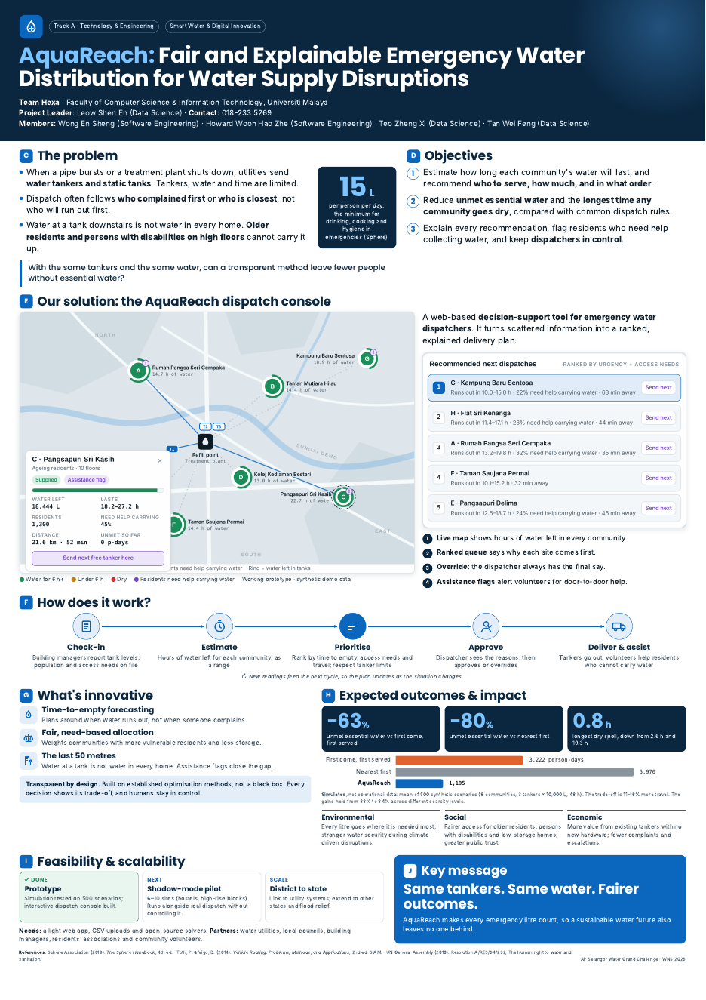
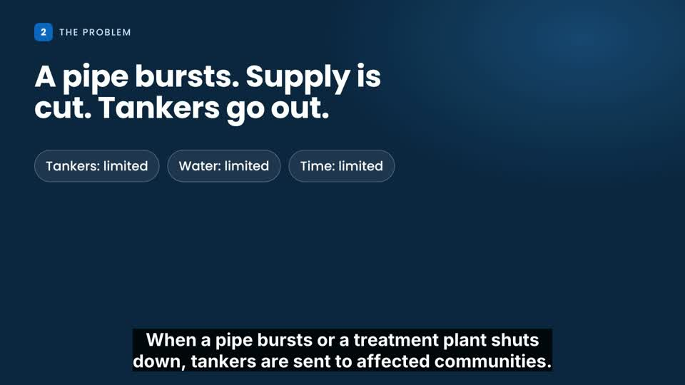

# AquaReach 💧

**Fair and explainable emergency water distribution for water supply disruptions**

Team **Hexa** · Faculty of Computer Science & Information Technology, Universiti Malaya
Air Selangor Water Grand Challenge · Water Nexus Symposium (WNS) 2026
Track A: Technology & Engineering Solutions · Smart Water & Digital Innovation

> **Same tankers. Same water. Fairer outcomes.**

---

## 🚀 Quick start (for teammates)

| I want to… | Open this |
|---|---|
| Browse the website edition of the pitch | [`web.html`](web.html): scroll-through version of the pitch deck (opens online at `/web.html` on GitHub Pages) |
| Try the working prototype | [`prototype/aquareach-dispatch-console.html`](prototype/aquareach-dispatch-console.html): download it and double-click to open in any browser, then press **Guided demo** |
| Read the written submission | [`docs/AquaReach_Proposal.pdf`](docs/AquaReach_Proposal.pdf) |
| See the poster (A1) | [`docs/AquaReach_Poster_A1.pdf`](docs/AquaReach_Poster_A1.pdf) |
| Watch the pitch video (~3 min, 1080p) | [`media/AquaReach_Pitch_Video.mp4`](media/AquaReach_Pitch_Video.mp4) |

No install, no build step. The prototype is one self-contained HTML file (it only loads Google Fonts online; it still works offline with fallback fonts).

---

## 📁 What's in this repo

```
aquareach/
├── README.md                              ← you are here
├── index.html                             ← redirects to the website (web.html) on GitHub Pages
├── web.html                               ← website edition of the pitch deck
├── prototype/
│   └── aquareach-dispatch-console.html    ← interactive dispatch console + simulation engine
├── docs/
│   ├── AquaReach_Proposal.pdf             ← competition submission form (5 pages)
│   └── AquaReach_Poster_A1.pdf            ← A1 poster
├── media/
│   └── AquaReach_Pitch_Video.mp4          ← pitch video (2:58, 1920×1080, ~84 MB)
└── assets/
    ├── web/                               ← images used by web.html
    ├── poster-preview.png                 ← small poster image used in this README
    └── video-thumbnail.jpg                ← video still used in this README
```

---

## ❓ The problem

When a pipe bursts, a treatment plant shuts down because of river pollution, or maintenance cuts supply, utilities in Selangor send **water tankers and static tanks** to affected communities. Tankers, water and time are all limited, so every dispatch decides who gets water and who waits.

Dispatch today often follows **who complained first** or **who is closest**, not **who will run out first**. Some communities run dry while others still have water in their tanks.

Delivery is also not the same as access: in high-rise flats, older residents and persons with disabilities may be unable to carry water from a tank downstairs to their homes.

The Sphere humanitarian standard sets a minimum of **15 L per person per day** in emergencies.

**Research question:** with the same tankers and the same water, can a transparent allocation method leave fewer people without essential water than first-come-first-served or nearest-first dispatch?

## 💡 Our solution

AquaReach is a **web-based decision-support tool for emergency water dispatchers**. It turns scattered information into a ranked, explained delivery plan.

1. **Live map** shows hours of water left in every community.
2. **Ranked queue** says *why* each site comes first (e.g. "Runs out in 2.4–3.6 h · 32% need help carrying water · 18 min away").
3. **Override:** the dispatcher always has the final say; the plan recalculates around the override.
4. **Assistance flags** alert volunteers for door-to-door help, closing the "last 50 metres".

### How it works

```
Check-in  →  Estimate  →  Prioritise  →  Approve  →  Deliver & assist
   ↑                                                        │
   └──────────── new readings feed the next cycle ──────────┘
```

| Step | What happens |
|---|---|
| **Check-in** | Building managers / residents' committees report tank levels through a simple form; population and access needs are on file. No new sensors needed. |
| **Estimate** | Hours of water left for each community, shown as a *range* (readings can be wrong). |
| **Prioritise** | Rank by time-to-empty, share of residents who need help, and travel time; respect tanker capacity, refill time and receiving-tank size. |
| **Approve** | Dispatcher sees the reasons and approves or overrides. |
| **Deliver & assist** | Tankers go out; volunteers help residents who cannot carry water. |

### What's innovative

- **Time-to-empty forecasting:** plans around when water runs out, not when someone complains.
- **Fair, need-based allocation:** weights communities with more vulnerable residents and less storage.
- **The last 50 metres:** water at a tank is not water in every home; assistance flags close the gap.
- **Transparent by design:** built on established optimisation methods, not a black box. Every decision shows its trade-off and humans stay in control.

## 📊 Results (simulated)

Mean of **500 synthetic scenarios** (8 communities, 3 tankers × 10,000 L, 48 hours):

| Strategy | Unmet essential water (person-days) | Longest dry spell |
|---|---:|---:|
| First come, first served | 3,222 | 2.6 h |
| Nearest first | 5,970 | 19.3 h |
| **AquaReach** | **1,195** | **0.8 h** |

- **−63%** unmet essential water vs first come, first served
- **−80%** vs nearest first
- Trade-off: **11–16% more tanker travel**
- Gains held from 38% to 84% across different scarcity levels

⚠️ These are simulation results on synthetic data, not operational data. The next step is validation with real data.

## 🖥️ The prototype in detail

`prototype/aquareach-dispatch-console.html` contains both the UI and the simulation engine (plain JavaScript, no framework).

**Demo scenario (synthetic):** Incident WS-0417, trunk main burst. 8 communities, 30,100 people, 3 tankers.

**Controls**
- **Dispatch strategy:** switch between *First come, first served*, *Nearest first* and *AquaReach* and compare.
- **Play / timeline scrubber / speed (1, 3, 6 h per second):** move through the 48 hours.
- **Click a community** on the map for details (water left, residents, % needing help, distance).
- **Send next:** manual dispatcher override.
- **Guided demo:** a narrated walk-through of all three strategies (good for presentations).
- Keyboard: `Space` play/pause, `Esc` stop demo / close panel.

**Model assumptions** (in the footer and code): essential demand 15 L/person/day; tanker 10,000 L at 25 km/h; 30 min unload; 30 min refill; AquaReach sees tank levels with ±20% error; requests reach the queue 0–4 h late.

**Where things are in the code**

| Thing | Look for |
|---|---|
| Constants (demand, tanker speed, etc.) | `const ESSENTIAL_LPD = 15 …` at the top of the `<script>` |
| The 8 communities (population, storage, vulnerability) | `const SITES = [...]` |
| AquaReach ranking logic | `function urgencyKey(...)` and `function rank(...)` |
| 48-hour simulation | `function simulate(policy, S, overrides)` |
| Map, queue, KPIs, chart rendering | `function render()` and friends |
| Guided demo script | `async function runDemo()` |

The engine exports itself for Node, so you can run it headless:

```bash
node -e "
const fs=require('fs');
const src=fs.readFileSync('prototype/aquareach-dispatch-console.html','utf8');
const js=src.match(/<script>([\s\S]*?)\(function\(\)\{/)[1];
const m={exports:{}}; new Function('module',js)(m);
const {prep,SITES,simulate}=m.exports; const S=prep(SITES);
for (const p of ['fcfs','nearest','aquareach']) {
  const r=simulate(p,S);
  console.log(p.padEnd(10), 'unmet', Math.round(r.unmet), 'p-days | longest dry', r.maxDry.toFixed(1), 'h | km', Math.round(r.km));
}"
```

(This single demo scenario gives different numbers from the 500-scenario averages above; that's expected.)

### Put it online with GitHub Pages (optional)

Live at https://shenenleow10521.github.io/aquareach/ (the root `index.html` redirects to `web.html`). The console is at `/prototype/aquareach-dispatch-console.html`. Every push to `main` redeploys automatically.

## 🗺️ Roadmap

| ✅ Done | ⏭️ Next | 📈 Scale |
|---|---|---|
| Simulation tested on 500 scenarios; interactive dispatch console built | Shadow-mode pilot at 6–10 sites (hostels, high-rise blocks), running alongside real dispatch without controlling it | Link to utility systems; extend to other states and flood relief |

**Needs:** a light web app, CSV uploads and open-source solvers.
**Partners:** water utilities, local councils, building managers, residents' associations, community volunteers.

## 👥 Team Hexa

| Name | Role / Programme |
|---|---|
| Leow Shen En | Project Leader · Data Science |
| Wong En Sheng | Software Engineering |
| Howard Woon Hao Zhe | Software Engineering |
| Teo Zheng Xi | Data Science |
| Tan Wei Feng | Data Science |

## 📚 References

- Sphere Association (2018). *The Sphere Handbook*, 4th ed.
- Toth, P. & Vigo, D. (2014). *Vehicle Routing: Problems, Methods, and Applications*, 2nd ed. SIAM.
- UN General Assembly (2010). Resolution A/RES/64/292, *The human right to water and sanitation*.

---

### Poster preview

[](docs/AquaReach_Poster_A1.pdf)

### Pitch video

[](media/AquaReach_Pitch_Video.mp4)

*Click the image, then "View raw" / download to watch (GitHub may not preview files over ~50 MB in the browser).*
